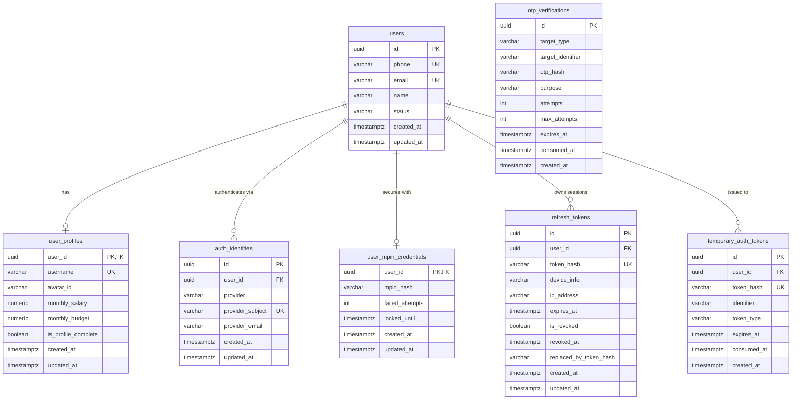

# Expensio Database Design & Schema Specification

This document details the normalized, production-grade PostgreSQL database schema designed for Expensio, managed through Flyway migrations and mapped to Spring Data JPA entities.

---

## 1. Architectural Principles

1. **Normalized & Resilient Identity Architecture:**
   - Single canonical user entity (`users`) decoupled from provider-specific authentication identities (`auth_identities`).
   - Prevents duplicate accounts resulting from case variations or formatting differences.
2. **Strict 1:1 Separation of Concerns:**
   - Core identity is separated from profile/onboarding preferences (`user_profiles`) and security credentials (`user_mpin_credentials`).
3. **Defense-in-Depth Secret Protection:**
   - Raw MPINs, OTPs, and refresh tokens are **never stored in plaintext**.
   - Ephemeral third-party tokens (e.g., Google/Apple OAuth access & ID tokens) are verified at the gateway and **never persisted as credentials**.
4. **Flyway-First Schema Evolution:**
   - Schema creation and versioning are strictly governed by Flyway SQL migrations.
   - Hibernate DDL auto-generation is disabled in production to guarantee predictable and reproducible schema state.

---

## 2. Table Specifications

### 2.1 `users`
Core user identity representing registered individuals.

| Column | Type | Constraints | Description |
| :--- | :--- | :--- | :--- |
| `id` | `UUID` | `PRIMARY KEY`, default `gen_random_uuid()` | Immutable internal user identifier |
| `phone` | `VARCHAR(20)` | `NULL`, Partial Unique Index | Normalized E.164 phone number |
| `email` | `VARCHAR(255)` | `NULL`, Partial Lowercase Unique Index | Normalized lowercase email address |
| `name` | `VARCHAR(100)` | `NOT NULL` | User's full or primary display name |
| `status` | `VARCHAR(30)` | `NOT NULL DEFAULT 'ACTIVE'` | Account status (`ACTIVE`, `SUSPENDED`, `DELETED`) |
| `created_at` | `TIMESTAMPTZ` | `NOT NULL DEFAULT CURRENT_TIMESTAMP` | Record creation timestamp |
| `updated_at` | `TIMESTAMPTZ` | `NOT NULL DEFAULT CURRENT_TIMESTAMP` | Record update timestamp |

- **Constraints & Indexes:**
  - `chk_users_phone_or_email`: `CHECK (phone IS NOT NULL OR email IS NOT NULL)` ensures every user has at least one primary reachable contact method.
  - `uq_users_phone`: Unique partial index on `phone` where `phone IS NOT NULL`.
  - `uq_users_email`: Unique partial index on `LOWER(email)` where `email IS NOT NULL`.
  - `idx_users_status`: Index for fast filtering on active accounts.

---

### 2.2 `user_profiles`
User onboarding, personalization, and automated budgeting settings.

| Column | Type | Constraints | Description |
| :--- | :--- | :--- | :--- |
| `user_id` | `UUID` | `PRIMARY KEY`, `REFERENCES users(id) ON DELETE CASCADE` | 1:1 shared primary key |
| `username` | `VARCHAR(50)` | `NULL`, Partial Lowercase Unique Index | Normalized unique handle (e.g., `@apeksha`) |
| `avatar_id` | `VARCHAR(50)` | `NULL` | Selected avatar identifier (e.g., `avatar_1`) |
| `monthly_salary` | `NUMERIC(12, 2)`| `NULL` | Monthly salary / income baseline |
| `monthly_budget` | `NUMERIC(12, 2)`| `NULL` | Monthly overall spend budget limit |
| `is_profile_complete`| `BOOLEAN` | `NOT NULL DEFAULT FALSE` | Flag indicating required onboarding completion |
| `created_at` | `TIMESTAMPTZ` | `NOT NULL DEFAULT CURRENT_TIMESTAMP` | Profile creation timestamp |
| `updated_at` | `TIMESTAMPTZ` | `NOT NULL DEFAULT CURRENT_TIMESTAMP` | Profile update timestamp |

- **Constraints & Indexes:**
  - `fk_user_profiles_user`: Cascading foreign key to `users(id)`.
  - `uq_user_profiles_username`: Unique index on `LOWER(username)` where `username IS NOT NULL`.
  - `idx_user_profiles_complete`: Fast lookup for onboarding state.

---

### 2.3 `auth_identities`
Links authentication providers to a user. Enables account linking across Phone, Google, Apple, and Email.

| Column | Type | Constraints | Description |
| :--- | :--- | :--- | :--- |
| `id` | `UUID` | `PRIMARY KEY`, default `gen_random_uuid()` | Identity row identifier |
| `user_id` | `UUID` | `NOT NULL`, `REFERENCES users(id) ON DELETE CASCADE` | Associated user |
| `provider` | `VARCHAR(30)` | `NOT NULL` | Provider type (`PHONE`, `GOOGLE`, `APPLE`, `EMAIL`) |
| `provider_subject`| `VARCHAR(255)`| `NOT NULL` | Provider unique ID (e.g. Google `sub`, Apple `sub`) |
| `provider_email` | `VARCHAR(255)` | `NULL` | Email recorded from provider OAuth assertion |
| `created_at` | `TIMESTAMPTZ` | `NOT NULL DEFAULT CURRENT_TIMESTAMP` | Identity link timestamp |
| `updated_at` | `TIMESTAMPTZ` | `NOT NULL DEFAULT CURRENT_TIMESTAMP` | Identity update timestamp |

- **Constraints & Indexes:**
  - `uq_auth_identities_provider_subject`: `UNIQUE (provider, provider_subject)` prevents account collisions across users.
  - `idx_auth_identities_user_id`: Fast identity lookup by user.
  - `idx_auth_identities_provider_email`: Lookup index on `LOWER(provider_email)`.

---

### 2.4 `user_mpin_credentials`
Stores hardware security PIN data for rapid biometric and PIN authentication.

| Column | Type | Constraints | Description |
| :--- | :--- | :--- | :--- |
| `user_id` | `UUID` | `PRIMARY KEY`, `REFERENCES users(id) ON DELETE CASCADE` | 1:1 shared primary key |
| `mpin_hash` | `VARCHAR(255)` | `NOT NULL` | Salted cryptographic hash of 4-digit PIN |
| `failed_attempts` | `INT` | `NOT NULL DEFAULT 0` | Consecutive failed verification count |
| `locked_until` | `TIMESTAMPTZ` | `NULL` | Account PIN lockout expiration |
| `created_at` | `TIMESTAMPTZ` | `NOT NULL DEFAULT CURRENT_TIMESTAMP` | MPIN creation timestamp |
| `updated_at` | `TIMESTAMPTZ` | `NOT NULL DEFAULT CURRENT_TIMESTAMP` | MPIN update timestamp |

- **Constraints & Indexes:**
  - `fk_user_mpin_user`: Foreign key linking to `users(id)`.

---

### 2.5 `otp_verifications`
Tracks one-time password lifecycle for phone and email verifications.

| Column | Type | Constraints | Description |
| :--- | :--- | :--- | :--- |
| `id` | `UUID` | `PRIMARY KEY`, default `gen_random_uuid()` | Verification record ID |
| `target_type` | `VARCHAR(20)` | `NOT NULL` | Target channel (`PHONE`, `EMAIL`) |
| `target_identifier` | `VARCHAR(255)` | `NOT NULL` | Normalized phone (`+919876543210`) or email |
| `otp_hash` | `VARCHAR(255)` | `NOT NULL` | Cryptographic hash of 6-digit OTP code |
| `purpose` | `VARCHAR(50)` | `NOT NULL` | Operation purpose (`LOGIN`, `REGISTRATION`, `RECOVERY`) |
| `attempts` | `INT` | `NOT NULL DEFAULT 0` | Failed verification attempts |
| `max_attempts` | `INT` | `NOT NULL DEFAULT 5` | Maximum allowed tries before invalidation |
| `expires_at` | `TIMESTAMPTZ` | `NOT NULL` | Expiration timestamp (typically 5 minutes) |
| `consumed_at` | `TIMESTAMPTZ` | `NULL` | When the OTP was successfully consumed |
| `created_at` | `TIMESTAMPTZ` | `NOT NULL DEFAULT CURRENT_TIMESTAMP` | Dispatch timestamp |

- **Indexes:**
  - `idx_otp_verifications_target`: Compound index on `(target_identifier, purpose, expires_at)`.
  - `idx_otp_verifications_consumed`: Index on `consumed_at`.

---

### 2.6 `temporary_auth_tokens`
Capabilities issued for multi-step onboarding, registration validation, and password/PIN recovery.

| Column | Type | Constraints | Description |
| :--- | :--- | :--- | :--- |
| `id` | `UUID` | `PRIMARY KEY`, default `gen_random_uuid()` | Token record ID |
| `user_id` | `UUID` | `NULL`, `REFERENCES users(id) ON DELETE CASCADE` | Associated user (if already provisioned) |
| `token_hash` | `VARCHAR(255)` | `NOT NULL UNIQUE` | Cryptographic hash of issued temporary capability |
| `identifier` | `VARCHAR(255)` | `NOT NULL` | Normalized phone or email |
| `token_type` | `VARCHAR(50)` | `NOT NULL` | Token scope (`REGISTRATION`, `RECOVERY`) |
| `expires_at` | `TIMESTAMPTZ` | `NOT NULL` | Capability expiration timestamp |
| `consumed_at` | `TIMESTAMPTZ` | `NULL` | Capability consumption timestamp |
| `created_at` | `TIMESTAMPTZ` | `NOT NULL DEFAULT CURRENT_TIMESTAMP` | Issuance timestamp |

- **Indexes:**
  - `uq_temporary_auth_tokens_hash`: Unique constraint and index on `token_hash`.
  - `idx_temp_tokens_lookup`: Compound index on `(identifier, token_type, expires_at)`.

---

### 2.7 `refresh_tokens`
Authoritative session state for JWT refresh tokens, rotation, and server-side revocation.

| Column | Type | Constraints | Description |
| :--- | :--- | :--- | :--- |
| `id` | `UUID` | `PRIMARY KEY`, default `gen_random_uuid()` | Session row ID |
| `user_id` | `UUID` | `NOT NULL`, `REFERENCES users(id) ON DELETE CASCADE` | User owning session |
| `token_hash` | `VARCHAR(255)` | `NOT NULL UNIQUE` | SHA-256 hash of issued refresh token |
| `device_info` | `VARCHAR(255)` | `NULL` | Device / client model string |
| `ip_address` | `VARCHAR(45)` | `NULL` | Client IP address |
| `expires_at` | `TIMESTAMPTZ` | `NOT NULL` | Session expiry (e.g. 30 days) |
| `is_revoked` | `BOOLEAN` | `NOT NULL DEFAULT FALSE` | Explicit revocation status |
| `revoked_at` | `TIMESTAMPTZ` | `NULL` | Timestamp of session revocation |
| `replaced_by_token_hash`| `VARCHAR(255)`| `NULL` | Rotated token link for replay protection |
| `created_at` | `TIMESTAMPTZ` | `NOT NULL DEFAULT CURRENT_TIMESTAMP` | Login timestamp |
| `updated_at` | `TIMESTAMPTZ` | `NOT NULL DEFAULT CURRENT_TIMESTAMP` | Last session update |

- **Indexes:**
  - `uq_refresh_tokens_hash`: Unique index on `token_hash`.
  - `idx_refresh_tokens_user_id`: Fast lookup for user session listings or bulk logout.
  - `idx_refresh_tokens_validity`: Compound index on `(expires_at, is_revoked)`.

---

## 3. Entity-Relationship Diagram



---

## 4. Normalization & Security Rules

1. **Email Normalization:**
   - Stored and queried strictly in lowercase (`LOWER(email)`).
   - Prevents accounts like `User@Expensio.app` and `user@expensio.app` from co-existing.
2. **Phone Normalization:**
   - E.164 formatted string (`+919876543210`) or sanitized 10-digit numeric digits without whitespace/dashes.
3. **Username / Handle Normalization:**
   - Normalized lowercase handle prefixed with `@` (`@apeksha`).
   - Unique partial index ensures uniqueness regardless of input casing.
4. **Secret Hashing:**
   - MPINs hashed using BCrypt.
   - OTPs hashed using salted SHA-256 / BCrypt.
   - Refresh tokens hashed with SHA-256 before database insertion to prevent offline token extraction in case of database backup exposure.

---

## 5. Local Setup & Supabase Connection

### Running Migrations via Flyway

When connecting to a development PostgreSQL instance or Supabase:

1. Provide environment variables in `.env` (or command line):
   ```bash
   DB_URL=jdbc:postgresql://<host>:5432/<database>?sslmode=require
   DB_USERNAME=postgres
   DB_PASSWORD=<your-db-password>
   FLYWAY_ENABLED=true
   ```
2. Run the application:
   ```bash
   mvnw.cmd spring-boot:run
   ```
   Flyway will automatically detect and apply `V1__create_auth_and_user_schema.sql` at startup.
